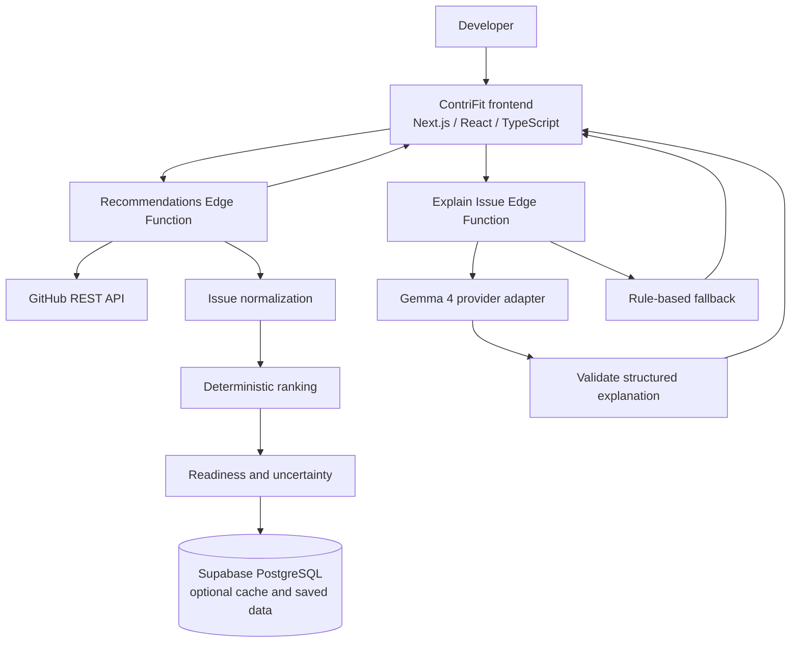

# ContriFit

**Find open-source issues that fit your skills. Understand why they fit. Know how to get started.**

ContriFit (short for **ContributionFit**) is an AI-assisted open-source contribution discovery platform that helps developers move from *“I want to contribute”* to *“I know which issue to investigate next.”* It matches a developer's declared skills and experience with real public GitHub issues, explains the evidence behind each recommendation, highlights skill gaps and uncertainty, and suggests practical first steps.

> **Project status:** In development. This README describes the intended product and architecture. Treat a capability as implemented only when it is present in the repository and verified in `PROJECT_STATUS.md` or by the relevant tests. The initial ranking system is heuristic and has not been validated against contribution outcomes.

**Design reference:** [ContriFit](https://cane-syrup-26599187.figma.site/)

---

## Contents

- [Why ContriFit?](#why-contrifit)
- [Core experience](#core-experience)
- [Product principles](#product-principles)
- [Technology stack](#technology-stack)
- [Architecture](#architecture)
- [Recommendation scoring](#recommendation-scoring)
- [Gemma 4 explanations](#gemma-4-explanations)
- [Data model](#data-model)
- [Getting started](#getting-started)
- [Environment variables](#environment-variables)
- [API overview](#api-overview)
- [Testing and quality checks](#testing-and-quality-checks)
- [Security and reliability](#security-and-reliability)
- [Deployment](#deployment)
- [Known limitations](#known-limitations)
- [Roadmap](#roadmap)
- [Documentation and references](#documentation-and-references)

## Presentation & Overview
You can view the project slide deck and architecture presentation here: [ContriFit Presentation Slides](https://docs.google.com/presentation/d/1Y4R4JG0_ftP1Btrc1Ql4aZ9NoqOUd9lR/edit?usp=sharing&ouid=117913180197404406162&rtpof=true&sd=true).

## Why ContriFit?

Finding an issue is only the first step in contributing to open source. Developers also need to judge whether the task matches their skills, whether the issue has enough context to begin, what they may need to learn, and what to investigate before changing code.

ContriFit aims to make those decisions easier by combining:

- **Personalized issue discovery** based on skills, experience, language, interests, and contribution type.
- **Explainable fit scores** with a transparent breakdown instead of an unexplained ranking.
- **Readiness signals** that describe how actionable an issue appears from available evidence.
- **Skill-gap analysis** that separates current strengths from possible prerequisites.
- **Evidence confidence and uncertainty** so missing information is not mistaken for a positive signal.
- **Gemma 4 explanations** that turn the underlying evidence into understandable guidance.
- **Direct links to real GitHub issues** so developers can review the source and make their own decisions.

ContriFit does not claim to be the first or only open-source issue discovery service. Its intended differentiation is the combination of personalized matching, transparent scoring, readiness analysis, uncertainty, and practical contribution guidance.

## Core experience

The main user journey is:

1. **Build a developer profile.** Enter skills, languages, frameworks, experience level, contribution types, and optional interests.
2. **Discover real issues.** Retrieve public issues from GitHub through its official API.
3. **Normalize the evidence.** Convert API responses into a consistent issue shape while preserving original GitHub metadata and URLs.
4. **Rank recommendations.** Apply a deterministic scoring engine to the profile and retrieved issue evidence.
5. **Assess readiness.** Identify available signals, missing context, possible prerequisites, and questions to verify.
6. **Explain the match.** Ask Gemma 4 to explain the existing score and evidence when model access is configured.
7. **Plan the first steps.** Review skill gaps, blockers, uncertainties, and a practical contribution checklist.
8. **Continue on GitHub.** Open the original issue and follow the repository's contribution process.

### What a recommendation should show

Each issue card should prioritize the information a developer needs to decide whether to investigate further:

- Issue title, number, repository, and original URL
- Available labels, language information, and activity timestamps
- Fit score and score breakdown
- Matching skills and possible skill gaps
- Readiness signals and evidence confidence
- Important missing information or questions to verify
- Optional Gemma 4 explanation and suggested first steps

Search, filters, sorting, loading states, empty states, API errors, retries, cached-result indicators, and AI-unavailable states are part of the product experience—not afterthoughts.

## Product principles

1. **Real data first.** Live recommendations must originate from GitHub API responses. No fabricated issues, repositories, labels, URLs, timestamps, or activity.
2. **Scores are explainable.** Keep the calculation deterministic, configurable, and testable.
3. **AI explains; it does not rank.** Gemma 4 must not override the score calculated by the ranking engine.
4. **Absence is not evidence of success.** Missing metadata must be surfaced or handled by an explicit policy.
5. **Confidence is not fit.** A strong match score does not mean the available evidence is complete or reliable.
6. **Readiness is not success probability.** An actionable-looking issue is not a guarantee that the contribution will be accepted or merged.
7. **Fail honestly.** If GitHub or Gemma 4 is unavailable, show the failure or a clearly identified fallback rather than pretending the live request succeeded.
8. **Security by default.** Keep credentials server-side and apply appropriate database access controls.
9. **Design continuity.** The published Figma Make site is the visual reference; inspect it before changing its design direction.

## Technology stack

| Layer | Preferred technology | Responsibility |
|---|---|---|
| UI and routing | Next.js, React, TypeScript | Responsive, accessible product interface |
| Styling | Tailwind CSS and reusable components | Consistent visual system aligned with the Figma reference |
| Database | Supabase PostgreSQL | Profiles, saved issues, and short-lived cached results |
| Backend/API | Supabase Edge Functions (TypeScript/Deno) | Secure orchestration, validation, GitHub integration, ranking, and AI calls |
| Issue source | GitHub REST API | Real public issue and repository metadata |
| Explanations | Gemma 4 via a verified supported runtime/provider | Natural-language explanation and contribution guidance |
| Version control | Git and GitHub | Source history, collaboration, and deployment workflow |
| Hosting | An eligible free-tier host compatible with the chosen frontend | Publish the application without requiring paid infrastructure for the MVP |

The preferred approach minimizes separate services: Supabase Edge Functions can handle the small server-side operations required for the MVP, so a separate Express service is not a default requirement. If the repository or deployment constraints justify a different architecture, document the reason before changing it.

Free tiers have quotas and eligibility conditions. Verify current limits before depending on them; this project must not silently activate paid services or incur charges.

## Architecture



### Main backend responsibilities

- **GitHub service:** search, pagination, timeouts, rate-limit handling, and upstream errors.
- **Issue normalization:** transform external responses into a stable internal schema and exclude pull requests from issue results.
- **Ranking service:** calculate the fit score, component scores, matching skills, and skill gaps.
- **Readiness service:** assess available clarity, actionability, activity, and repository-context signals without inventing missing evidence.
- **AI service:** call Gemma 4, validate its output, and produce a rule-based fallback when inference is unavailable.
- **Persistence/cache:** store user-owned data and optionally cache normalized search results with explicit freshness metadata.

### Intended repository layout

Adjust these paths to the actual repository as implementation progresses; this is the target separation of responsibilities, not a claim that every file already exists.

```text
contrifit/
├── app/                         # Next.js routes and pages
├── components/                  # Shared UI components
├── lib/
│   ├── supabase/                # Browser/server Supabase clients
│   ├── schemas/                 # Shared validation schemas and types
│   └── api/                     # Frontend API clients
├── supabase/
│   ├── migrations/              # Repeatable database schema changes
│   └── functions/
│       ├── recommendations/     # GitHub retrieval, ranking, readiness
│       └── explain-issue/       # Gemma 4 explanations and fallback
├── tests/                       # Unit and integration tests
├── .env.example                 # Names/placeholders only; no secrets
├── PROJECT_STATUS.md            # Verified implementation status
└── README.md
```

## Recommendation scoring

ContriFit uses an initial weighted heuristic to estimate how well an issue fits a developer's profile. The weights are hypotheses to be tested and improved, not validated scientific measurements.

\[
\text{Fit Score} = 0.30S + 0.25D + 0.15C + 0.15R + 0.15F
\]

| Signal | Weight | Meaning |
|---|---:|---|
| Skill match (`S`) | 30% | Alignment between declared skills and evidence available in the issue/repository context |
| Difficulty fit (`D`) | 25% | How closely the task's apparent complexity aligns with the developer's experience level |
| Issue clarity (`C`) | 15% | How understandable and specific the available task description appears |
| Repository readiness (`R`) | 15% | Whether available repository and issue context supports getting started |
| Freshness and activity (`F`) | 15% | Signals derived from real issue timestamps and available activity metadata |
| **Total** | **100%** | |

Each component is normalized to `0–100`. The calculated score is clamped to the same range. Keep weights in one configuration location and use deterministic sorting and tie-breaking.

### Related concepts that must remain separate

- **Fit score:** estimated alignment between the developer and issue evidence.
- **Readiness:** how actionable the issue appears from the evidence available.
- **Evidence confidence:** how complete and reliable the evidence is.
- **Contribution success probability:** not calculated or claimed by the initial heuristic.

### Missing-data policy

Missing data must never silently count as positive evidence. Choose and document a consistent policy—for example, use an explicitly neutral component where justified while reducing evidence confidence, or apply a transparent missing-data adjustment. The response should identify which signals were unavailable. An issue with incomplete metadata must not be presented as fully assessed.

### Skill matches and gaps

Compare the user's explicitly declared skills against relevant issue text, labels, and repository metadata that were actually retrieved. Distinguish direct evidence from inference. Do not infer a skill solely because the repository uses a particular programming language, and do not claim the ranking has been validated against contribution outcomes until such validation exists.

## Gemma 4 explanations

Gemma 4 is an **explanation layer**, not the ranking engine. It receives the developer profile, normalized issue metadata, existing score breakdown, matching skills, potential gaps, readiness signals, evidence confidence, and uncertainties. It should produce actionable guidance grounded in that information.

Expected structured response fields:

- `summary`
- `whyItFits`
- `matchingSkills`
- `skillGaps`
- `potentialBlockers`
- `suggestedFirstSteps`
- `questionsToVerify`
- `uncertainties`

Validate model output before returning it to the frontend. Treat issue descriptions and repository text as untrusted input; they must not override application instructions or cause secrets to be exposed. The model must not invent repository facts, maintainer decisions, test results, issue links, or contribution outcomes.

### Fallback behavior

The core discovery and ranking journey should remain usable without a Gemma API key. If inference is unavailable, return a rule-based explanation from the existing evidence and mark it as a fallback. Never label rule-based text as Gemma-generated.

The Google Gemini API documentation currently lists hosted Gemma 4 model identifiers including `gemma-4-26b-a4b-it` and `gemma-4-31b-it`. Verify that the chosen identifier and access route are still available, and check current quotas, pricing, and terms before enabling it. See [Gemma on the Gemini API](https://ai.google.dev/gemma/docs/core/gemma_on_gemini_api).

## Data model

The initial data model can remain small. Add tables only when they are required by the actual user journey.

| Table | Purpose | Example fields |
|---|---|---|
| `profiles` | Persist developer preferences when persistence/authentication is enabled | `id`, `skills`, `experience_level`, `preferred_language`, `contribution_types`, `interests`, timestamps |
| `saved_issues` | Save issues for later review | `id`, `user_id`, `github_issue_id`, `issue_url`, `issue_snapshot`, `created_at` |
| `issue_cache` | Reduce repeated upstream requests | `cache_key`, `payload`, `fetched_at`, `expires_at` |

Use UUIDs for internal IDs where appropriate, JSONB for flexible collections or issue snapshots, and explicit timestamps for freshness. User-owned rows must be protected by Row Level Security. The cache should be writable only through trusted server-side operations.

Authentication may be deferred if it slows the first end-to-end demo. If it is deferred, avoid implying that profiles and saved issues are securely synchronized across devices.

## Getting started

> **Note:** The setup commands below describe the intended Next.js + Supabase implementation. Confirm that the generated repository contains the referenced scripts and function names before treating the commands as verified for a particular checkout. The repository's actual `package.json`, Supabase configuration, and `PROJECT_STATUS.md` are authoritative for current status.

### Prerequisites

- Node.js compatible with the installed Next.js version (current Next.js installation documentation specifies Node.js 20.9 or later)
- npm, pnpm, or the package manager specified by the repository lockfile
- A Supabase account/project for hosted persistence and Edge Functions
- A GitHub account (public issue search can begin without a personal token)
- Optional Google AI Studio API key for Gemma 4 explanations
- Git; Supabase CLI and a Docker-compatible runtime if running the full local Supabase stack

### 1. Get the project

```bash
git clone <your-repository-url>
cd contrifit
```

If the repository has not yet been created, create or generate the application first and then use the actual repository URL and directory name.

### 2. Install dependencies

Use the package manager that matches the checked-in lockfile:

```bash
npm install
```

### 3. Configure environment variables

Create `.env.local` for frontend development and configure Supabase Edge Function secrets separately. Start from `.env.example`; never commit real secret values.

### 4. Run the frontend

```bash
npm run dev
```

Open the local URL printed by the development server (the standard Next.js default is `http://localhost:3000`).

### 5. Configure Supabase

If the project uses Supabase CLI and the required local tools are installed:

```bash
npx supabase login
npx supabase link --project-ref <your-project-ref>
npx supabase functions list
```

Run the migrations and deployment commands that actually exist in the repository. Do not run a guessed migration or deploy an unreviewed function to a production project.

### 6. Configure server-side secrets

Set `GEMMA_API_KEY` and an optional `GITHUB_TOKEN` as Edge Function secrets through the Supabase Dashboard or CLI. Never place these values in `NEXT_PUBLIC_*` variables or browser code. For local Edge Function development, use the local secrets file documented by Supabase and ensure it is ignored by Git.

### 7. Verify the setup

Run the available quality checks, for example:

```bash
npm run lint
npm run typecheck
npm test
npm run build
```

These scripts must exist in `package.json` before the commands can work. If a script is not present, add it as part of implementation or use the actual supported equivalent. Report only checks that genuinely ran and passed.

## Environment variables

The exact names should match the implementation. This is the intended configuration contract.

| Variable | Where | Required? | Purpose |
|---|---|---|---|
| `NEXT_PUBLIC_SUPABASE_URL` | Frontend | Yes for browser Supabase access | Supabase project URL |
| `NEXT_PUBLIC_SUPABASE_PUBLISHABLE_KEY` | Frontend | Yes if using the current publishable-key flow | Publishable browser key; rely on RLS for data protection |
| `NEXT_PUBLIC_SUPABASE_ANON_KEY` | Frontend | Legacy alternative only if the project uses the legacy key flow | Legacy anon key; do not configure both without a reason |
| `GEMMA_API_KEY` | Edge Function secret | Optional | Private Google AI Studio/Gemini API key for Gemma 4 |
| `GEMMA_MODEL` | Edge Function configuration | Optional; set a verified value | Gemma 4 model identifier, such as `gemma-4-26b-a4b-it` if currently available to the project |
| `GITHUB_TOKEN` | Edge Function secret | Optional | Server-side token if authenticated GitHub requests are needed |
| `NEXT_PUBLIC_APP_URL` | Frontend/deployment configuration | Deployment-dependent | Public application origin for redirects or URL generation |

Supabase Edge Functions receive certain Supabase environment values from the runtime. Do not copy a Supabase secret/service-role key into frontend configuration. The public/publishable key is only safe to use in the browser when database access is correctly protected by RLS and server-side authorization rules.

Example `.env.example` (placeholders only):

```dotenv
NEXT_PUBLIC_SUPABASE_URL=https://YOUR_PROJECT_REF.supabase.co
NEXT_PUBLIC_SUPABASE_PUBLISHABLE_KEY=YOUR_PUBLISHABLE_KEY
# Optional legacy alternative if required by this repository:
# NEXT_PUBLIC_SUPABASE_ANON_KEY=YOUR_LEGACY_ANON_KEY
NEXT_PUBLIC_APP_URL=http://localhost:3000

# Configure these as server-side Supabase Edge Function secrets, not frontend variables:
# GEMMA_API_KEY=
# GEMMA_MODEL=gemma-4-26b-a4b-it
# GITHUB_TOKEN=
```

## API overview

The exact function names and response types must match the deployed Supabase functions. The following is the intended API contract.

### `POST /functions/v1/recommendations`

Retrieves and normalizes real public GitHub issues, applies filters, calculates fit scores, assesses readiness, and returns ranked results.

Example request:

```json
{
  "profile": {
    "skills": ["JavaScript", "React", "Node.js"],
    "experienceLevel": "beginner",
    "preferredLanguage": "JavaScript",
    "contributionTypes": ["frontend", "bug-fix"],
    "interests": ["developer tools"]
  },
  "filters": {
    "labels": ["good first issue"],
    "repositories": [],
    "limit": 20
  }
}
```

The values above are illustrative request data, not live recommendations.

A recommendation response should include the normalized issue, `fitScore`, `scoreBreakdown`, `matchingSkills`, `skillGaps`, `readinessSignals`, `evidenceConfidence`, and `uncertainties`. Response metadata should identify the source, server-generated retrieval timestamp, cache status, AI status where applicable, and result-limit or pagination information.

### `POST /functions/v1/explain-issue`

Generates a validated Gemma 4 explanation for an existing recommendation. It must consume the already-calculated ranking and must not recalculate or modify its score. If inference is unavailable, it returns an explicitly identified rule-based fallback where possible.

### Health and persistence operations

A health check can be added to verify backend availability. Profile and saved-issue operations should be added only when persistence is part of the chosen user journey. All endpoints need input validation, predictable error responses, sensible request limits, and documented authentication requirements.

## Testing and quality checks

Tests should cover the following areas as the application is implemented.

### GitHub integration

- Successful retrieval and pagination
- Normalization of optional and missing fields
- Pull-request exclusion
- Closed-issue filtering
- Upstream API errors, timeouts, and rate limits
- Cache freshness and expiry

### Ranking and readiness

- Correct weighted calculation and score bounds
- Skill matches and skill gaps
- Difficulty/clarity/readiness heuristics
- Explicit missing-data handling
- Evidence confidence and uncertainty
- Deterministic ordering and tie-breaking
- Avoidance of unsupported claims

### Gemma 4

- Valid structured response
- Malformed output and schema validation
- Missing API key and provider failures
- Timeouts and bounded retries
- Rule-based fallback
- Confirmation that AI cannot override fit scores

### Frontend and end-to-end flow

- Profile validation
- Search, filter, and sort behavior
- Loading, empty, error, and retry states
- AI-unavailable state
- Original GitHub URLs
- Responsive layout and keyboard navigation
- Frontend/backend integration

Run linting, type-checking, unit tests, integration tests, and production builds where supported. Distinguish mocked tests from live requests and actual model inference. A test is not “passed” until it has actually run successfully.

## Security and reliability

- Keep API keys and privileged credentials in server-side secrets.
- Never expose service-role keys or other RLS-bypassing secrets in browser bundles.
- Enable Row Level Security for user-owned data and test access policies.
- Validate all client input and constrain request sizes.
- Use timeouts and bounded retries for external APIs.
- Respect GitHub and model provider rate limits.
- Apply deliberate CORS and rate-limiting policies.
- Treat issue bodies and model output as untrusted text; render safely.
- Validate outbound issue links and use the original URL returned by GitHub.
- Never log secrets.
- Do not expose private-repository data without explicit authenticated support and authorization.
- Do not claim an issue is unclaimed or guaranteed to be accepted without reliable evidence.

For current Supabase Edge Function behavior and secret management, consult the [Edge Functions guide](https://supabase.com/docs/guides/functions) and [Edge Function secrets documentation](https://supabase.com/docs/guides/functions/secrets).

## Deployment

A zero-cost-first deployment can use Supabase Free for the database and Edge Functions, plus an eligible free hosting service for a Next.js frontend. Actual free-tier limits, eligibility, and account requirements must be checked before deployment.

Deployment checklist:

- [ ] Verify the Figma reference and implemented visual match.
- [ ] Configure production frontend environment variables.
- [ ] Configure Gemma 4 and optional GitHub credentials as server-side secrets.
- [ ] Apply database migrations and verify RLS policies.
- [ ] Deploy and invoke the required Edge Functions.
- [ ] Test live GitHub discovery and rate-limit behavior.
- [ ] Test Gemma 4 inference and fallback behavior.
- [ ] Verify loading, empty, error, and retry states.
- [ ] Run production build and relevant tests.
- [ ] Open the deployed site on desktop and mobile.
- [ ] Record the deployment URL and actual verification results in `PROJECT_STATUS.md`.

Do not activate paid services or upgrades without explicit authorization. If a free quota or account restriction blocks a capability, document it rather than masking the failure.

## Known limitations

- The fit formula and component heuristics are initial, unvalidated hypotheses.
- GitHub metadata may be incomplete, and labels do not reliably express task difficulty.
- Recent issue activity does not guarantee the issue is still available or suitable.
- Repository readiness cannot be assessed beyond the information the application actually retrieves.
- Gemma 4 output can be incomplete or incorrect; schema validation and evidence-grounded prompts reduce but do not eliminate this risk.
- Contribution success, maintainer response, issue assignment, and pull-request acceptance are outside the application's control.
- Availability and limits of hosted model access, GitHub API access, Supabase, Figma, and hosting depend on current provider policies and account plans.

## Roadmap

The roadmap is complete when the corresponding functionality is implemented and tested—not just when a UI has been generated.

- [ ] Inspect the Figma reference and document the verified design system.
- [ ] Implement the reference-aligned responsive frontend.
- [ ] Create the Supabase schema and access policies.
- [ ] Implement live GitHub issue discovery and normalization.
- [ ] Build deterministic ranking with transparent evidence.
- [ ] Implement readiness, confidence, and uncertainty.
- [ ] Integrate Gemma 4 with validation and fallback.
- [ ] Connect profile, results, filters, details, and saved issues as applicable.
- [ ] Add automated tests and fix discovered defects.
- [ ] Deploy using eligible free-tier services.
- [ ] Update status documentation with verified results and known blockers.

## Documentation and references

- [ContriFit design reference](https://cane-syrup-26599187.figma.site/)
- [Next.js documentation](https://nextjs.org/docs)
- [Supabase documentation](https://supabase.com/docs)
- [Supabase Edge Functions](https://supabase.com/docs/guides/functions)
- [Supabase Edge Function secrets](https://supabase.com/docs/guides/functions/secrets)
- [GitHub REST API documentation](https://docs.github.com/en/rest)
- [GitHub REST API rate limits](https://docs.github.com/en/rest/using-the-rest-api/rate-limits-for-the-rest-api)
- [Gemma on the Gemini API](https://ai.google.dev/gemma/docs/core/gemma_on_gemini_api)
- [Google AI Studio](https://aistudio.google.com/)

---

**ContriFit / ContributionFit** — make your next open-source contribution a better-informed one.
